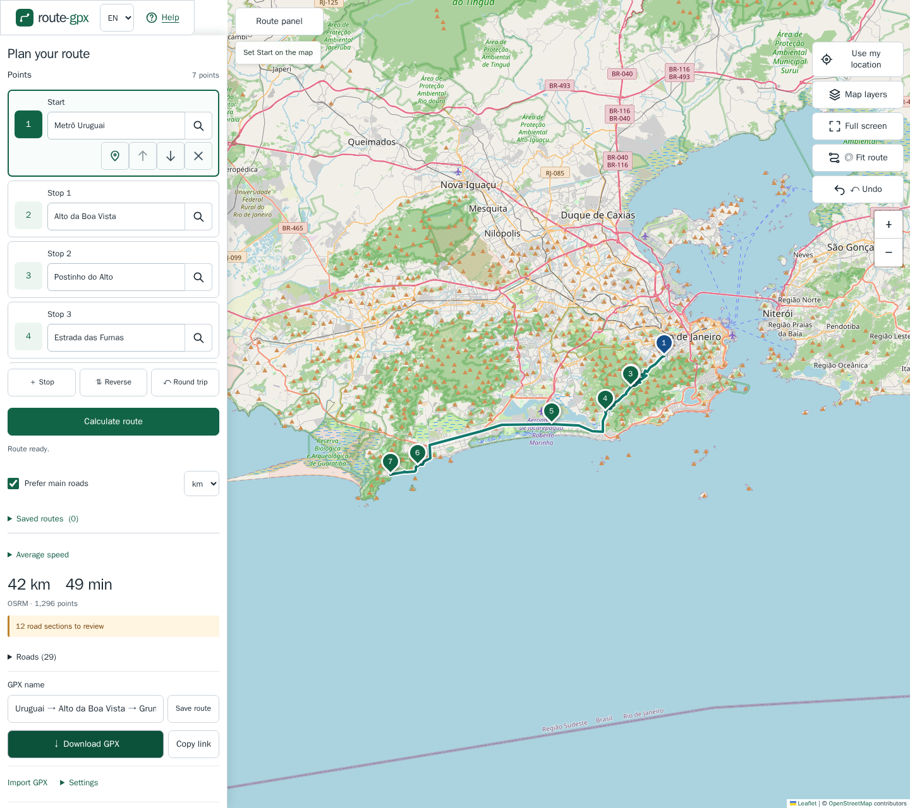

# route-gpx

Plan routes and export the complete track as GPX.

[Open the app](https://t00ls-dev.github.io/route-gpx/) · [Português](README.pt-BR.md) · [Help](https://t00ls-dev.github.io/route-gpx/help.html) · [MIT license](LICENSE)



## Features

- Full viewport map with a collapsible side panel on desktop, a bottom sheet on mobile and full screen controls. Locate yourself with permission, then optionally choose an approximate route point.
- Define start, destination and stops with addresses, coordinates or map clicks.
- Move and reorder points, reverse the route, add a return trip and undo changes.
- Review distance, estimated duration and road references; switch between kilometers and miles or set an average speed.
- Import GPX and export GPX 1.1 with complete track segments and named waypoints.
- Share route links and explicitly save named routes in this browser, with JSON backup import/export.

A static application built with HTML, TypeScript, Vite and Leaflet. No account, API key or application backend is required. The interface supports English and Brazilian Portuguese through the header selector.

## Quick start

1. Enter addresses or `latitude, longitude` in **Start** and **Destination**, or click the map on desktop. On touch screens, hold a map point for about half a second and choose its role. Coordinates apply automatically; for addresses, press **Search** or Enter and select a result. Suggestions appear while typing; arrows and Enter select one. Without a selected suggestion, **Search** or Enter uses Nominatim explicitly.
2. Add stops and adjust the points. Review the calculated route, distance and duration.
3. Optionally enter a **GPX name**, then press **Download GPX**. The name applies to both the file and track; when blank, the endpoints are used.

On small screens, map tools use a single column of icon buttons, including Undo, beside zoom. Their tooltips and accessible names identify each action. Address fields include a search icon; the pin icon selects a point on the map. The Help icon explains touch gestures. Saved routes sits above Average speed, after the editing controls.

When supported by your browser, **Share GPX** opens the device share menu with the same named GPX file; cancelling is silent. **Download GPX** remains available. A desktop right-click (or Shift+F10 on the focused map) opens the point menu. Route drawing is simplified for the current zoom only; GPX, saved and imported geometry remain complete.

For step-by-step instructions, use the [Help page](https://t00ls-dev.github.io/route-gpx/help.html).

## Important behavior

- Imported GPX files can be up to 10 MB. Track points and segments remain intact until you edit a point, which recalculates the route. Share links contain control points and options, not imported geometry, and recalculate when opened.
- Routes are **never saved automatically**. Enter a name and use **Save route** to store the exact geometry in IndexedDB. Saving with the same name updates the entry. Reopening a saved route does not recalculate it. Export backups: clearing browser data can remove saved routes.
- Routing currently uses a car profile. **Prefer main roads** flags possible local sections; it does not guarantee their exclusion. Estimates exclude stops and real-time traffic. Review the result before using it.
- Language and distance units are independent. Changing units does not alter GPX coordinates. Optional average speed changes the time estimate; disabling it restores the router estimate.

## Services and privacy

The site uses the selected tile provider, OSRM for routing, Valhalla as a fallback, Photon for suggestions and Nominatim for explicit address search. Maps, search and routing require an internet connection. These providers receive the locations needed for each request; shared links and backups also contain locations. The application sets no cookies or analytics.

The initial view uses, in order: a route in the URL, GPS already authorized in the browser, an approximate IP region, then browser language and timezone (offline), with a world view as the final fallback. **Use my location** explains the purpose before you continue to the browser permission prompt. Exact GPS coordinates stay in memory only, are never stored in links, localStorage, sessionStorage or IndexedDB, and are never sent to project servers or routing/search services. Choosing **Set as start** or **Add as stop** explicitly creates a rounded coordinate (about a 100 m grid) that follows normal route sharing, routing and saving behavior. Review it on the map. The tile provider receives requests for the visible map area, including when centered by GPS.

**Detect region by IP** is enabled by default and can be disabled in **Settings**; its service URL is configurable. [ipwho.is documentation](https://ipwhois.io/documentation) and [terms](https://ipwhois.io/terms) provide a free HTTPS, CORS-enabled endpoint without a key. Its published limit is 1,000 requests/day, shared by domain for browser CORS traffic; commercial use is allowed, with no availability guarantee. The browser sends its IP address to the selected provider, as it also does to tile servers. The app makes at most one attempt per tab session, with a 3 s timeout and no retries. Only an approximate city center is cached in memory; a session flag prevents repeated requests after reload. Failure silently uses the local language/timezone view. Preferences and panel state contain no location data.

Address suggestions use [Photon](https://github.com/komoot/photon#demo-server) at `https://photon.komoot.io` (configurable in Settings). Its policy permits reasonable project use, with no numeric quota or availability guarantee; heavy use can be blocked. HTTPS and open CORS were verified. Typed address text and a city-scale map-center bias are sent after 3 characters and a 300 ms pause, with a five-result limit, cancellation, memory cache and serialized starts at least 1 s apart. Numeric coordinate input, including incomplete coordinates, does not request suggestions. Nominatim is used only by Search/Enter, including after a Photon failure, never automatically while typing. Requests are spaced and cached where applicable, but public services have limited capacity and no availability guarantee. Follow the [Nominatim policy](https://operations.osmfoundation.org/policies/nominatim/) and [tile policy](https://operations.osmfoundation.org/policies/tiles/); configure your own services before scaling usage. Browser-side spacing cannot enforce a shared usage limit across all devices.

Change service base URLs in **Settings**. Remote services need HTTPS and must allow browser cross-origin requests. For self-hosting, consult the [OSRM documentation](https://github.com/Project-OSRM/osrm-backend#quick-start) and [Nominatim documentation](https://nominatim.org/release-docs/latest/admin/Installation/).

The Map layers control loads layers only when active; satellite Labels are optional and initially enabled. The selection and satellite edition are device preferences, outside route links and saved routes. The active tile provider receives your IP address and visible-area tile requests; labels send additional visible-area requests to EOX. No tile prefetching, offline storage or service worker is added. Zoom beyond native resolution enlarges existing tiles; it adds no detail.

| Layer                             | Source and terms                                                                                                                      | Native zoom |
| --------------------------------- | ------------------------------------------------------------------------------------------------------------------------------------- | ----------- |
| Standard                          | [OpenStreetMap](https://operations.osmfoundation.org/policies/tiles/), ODbL data and attribution-required tiles                       | 19          |
| Topographic                       | [OpenTopoMap](https://opentopomap.org/about#verwendung), OSM/SRTM, CC BY-SA 3.0; embedding permitted with attribution                 | 17          |
| Satellite                         | [EOxCloudless 2025](https://cloudless.eox.at/documentation/license), Sentinel-2 mosaic, CC BY-NC-SA 4.0; non-commercial projects only | 14          |
| Satellite alternative in Settings | [EOxCloudless 2016](https://cloudless.eox.at/documentation/faq), CC BY 4.0; also permits commercial embedded use                      | 14          |
| Labels                            | [EOX::Maps bright overlay](https://maps.eox.at/), OSM data/ODbL; embedding permitted with OSM, EOX and MapServer credits              | 14          |

These services have no availability guarantee; follow fair use, retain attribution, and contact providers before scaling. EOX publishes no numeric quota and may throttle spikes. Its newer public mosaics prohibit commercial production use; choose 2016 for that use. Satellite is a regional, approximately 10 m mosaic, not street-level or live imagery. Esri World Imagery was evaluated and excluded: its [linked terms summary](https://goto.arcgis.com/termsofuse/viewsummary) requires Esri software or an ArcGIS subscription, incompatible with this account-free setup. The imagery licenses do not change the application's MIT code license; map screenshots retain the respective imagery terms and credits.

## Local development

Use Node.js **22.12 or newer**:

```sh
npm ci
npm run dev
```

Open `http://localhost:5173/route-gpx/`. To build and preview the production version:

```sh
npm run build
npm run preview
```

## Validation

Install Chromium once for browser tests, then run the checks:

```sh
npx playwright install chromium
npm run lint
npm run format:check
npm test
npm run test:browser
npm run build
```

Vitest covers core logic and Playwright covers browser workflows. Regular tests mock public services. The optional `npm run test:integration` calls real OSRM.

The separate `node scripts/browser-check.mjs` acceptance script requires a running local server, or `SITE_URL` pointing to a deployed site. It calls real services and updates screenshots, the sample GPX and the report in `docs/`; run it only when those checks are needed.

## Deployment

GitHub Actions runs checks on pull requests and pushes to `main`. Successful builds of the current `main` commit deploy to GitHub Pages. Vite uses `/route-gpx/` as its base path; if changing the hosting path, also update manifest paths, canonical and sharing URLs, sitemap and documentation. See [brand and hosting notes](docs/BRAND.md).

## Credits and license

Built with [Leaflet](https://leafletjs.com/), [OSRM](https://project-osrm.org/), [Valhalla](https://valhalla.github.io/valhalla/), [Nominatim](https://nominatim.org/), [Photon](https://github.com/komoot/photon), [Vite](https://vite.dev/) and [Vitest](https://vitest.dev/). IP region by [ipwho.is](https://ipwhois.io/). Additional maps by [OpenTopoMap](https://opentopomap.org/about) and [EOX](https://maps.eox.at/). Map data © [OpenStreetMap contributors](https://www.openstreetmap.org/copyright).

Application code is licensed under [MIT](LICENSE). Data and dependencies retain their own licenses. No affiliation with the public service operators.

[Report a bug or contact the maintainer](https://github.com/t00ls-dev/route-gpx/issues) · [Report a map issue](https://www.openstreetmap.org/fixthemap)
