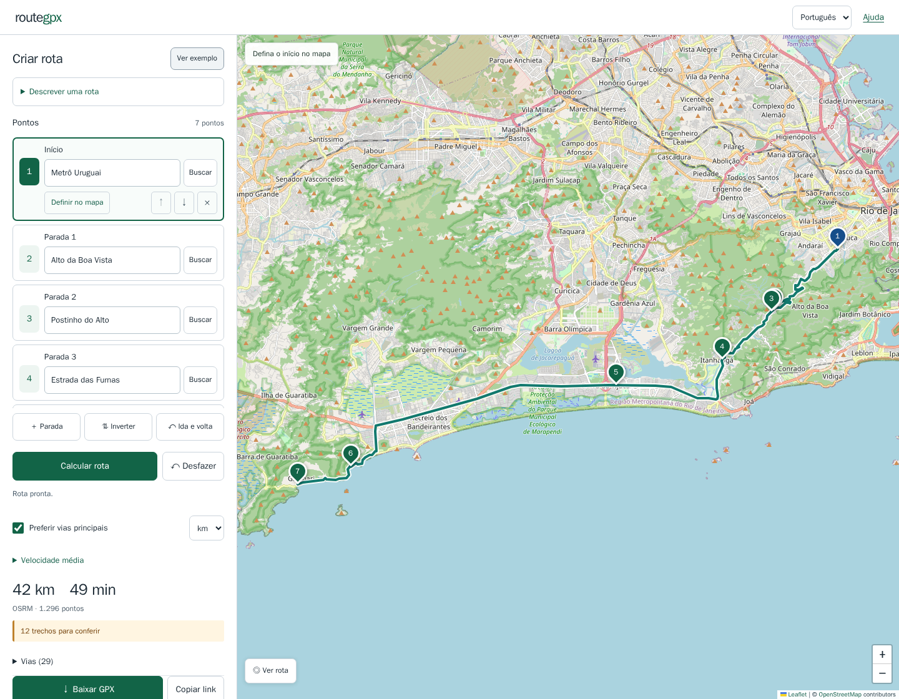

# route-gpx

Crie rotas de carro e baixe o traçado completo pelas ruas em GPX.

[Abrir o site](https://t00ls-dev.github.io/route-gpx/) · [English](README.md) · [Licença MIT](LICENSE)



[Versão para celular](docs/mobile.png)

Site estático em HTML, TypeScript strict, Vite e Leaflet. Sem backend, chave de API, cadastro, cookies ou analytics. Inglês e português do Brasil são nativos; selecione o idioma no cabeçalho.

A interface é clara e tem contraste forte, mesmo se o sistema preferir tema escuro. Instruções e privacidade ficam na página separada de [Ajuda](https://t00ls-dev.github.io/route-gpx/help.html?lang=pt), deixando a criação mais compacta no celular.

## Como usar

1. Digite endereço ou `latitude, longitude` diretamente nos campos **Início** e **Destino**. Coordenadas são aplicadas automaticamente. Para um endereço, toque em **Buscar** ou Enter e escolha um resultado. Também é possível clicar duas vezes no mapa.
2. Arraste marcadores, reordene pelas setas, adicione ou remova pontos. A rota recalcula automaticamente após uma pequena espera; **Calcular rota** permite repetir o cálculo.
3. Confira distância, duração, referências de rodovias e lista de vias. A preferência por vias principais avisa sobre possíveis trechos locais; não garante exclusão de vias locais. Adicione pontos nas vias desejadas.
4. Baixe o GPX 1.1 com todos os pontos da geometria dentro de `trk/trkseg`, pontos nomeados em `wpt`, nome e data. Abra no [gpx.studio](https://gpx.studio/) ou outro aplicativo.

O exemplo é **Metrô Uruguai → Alto da Boa Vista → Postinho do Alto → Estrada das Furnas → Barra da Tijuca → Prainha → Grumari**, com chegada na Avenida Estado da Guanabara junto à praia. O ponto do Postinho fica na Rua da Boa Vista, fora do pátio. A rota sobe a Avenida Edison Passos e desce pelas Furnas. [GPX de exemplo](docs/example.gpx).

**Desfazer** recupera até 50 alterações nesta aba, incluindo pontos movidos, removidos ou reordenados. Ctrl+Z / ⌘Z funciona fora dos campos de texto. O seletor **km / mi** troca quilômetros por milhas, independentemente do idioma. A escolha fica no link e não altera as coordenadas do GPX.

**Velocidade média** calcula o tempo pela distância e a velocidade escolhida em km/h ou mph. Limpe o campo para voltar à estimativa do roteador. A conta não inclui paradas nem trânsito.

## Descrever uma rota

> De Metrô Uruguai passando por Alto da Boa Vista passando por Postinho do Alto passando por Estrada das Furnas passando por Barra da Tijuca passando por Prainha até Grumari. Prefira vias principais.

Também aceita `From A via B to C`, setas e um local por linha. **Revisar** exibe lugares editáveis, sem consultar serviços. Só após **Criar rota** os endereços são buscados, em sequência. Confira os marcadores: a resolução usa o primeiro resultado. Uma região de busca opcional ajuda a distinguir lugares com nomes iguais.

O interpretador funciona no navegador e reconhece instruções estruturadas. Não é uma IA geral. Instruções vagas, restrições de elevação e pedidos de segurança, trânsito ou exclusão total de vias locais não são resolvidos automaticamente. O editor de pontos permanece disponível. Há também um editor JSON em **Configurações → Avançado: JSON**.

## Importar, compartilhar e ida e volta

A importação aceita GPX até 10 MB e preserva todos os pontos e segmentos originais até uma edição. Os pontos de controle são derivados das extremidades, waypoints ou de uma amostra; editar recalcula pelas ruas. O link contém os controles e as opções, não a geometria importada, e recalcula a rota ao abrir. Os pontos solicitados podem ser ajustados à via de carro mais próxima; deslocamentos acima de 100 m são avisados.

**Ida e volta** acrescenta um itinerário de retorno, calculado pelas vias permitidas. Revise pontos sobre pistas separadas para evitar retornos desnecessários. As estimativas não incluem paradas nem trânsito em tempo real.

## Rodar e verificar

Node.js 22.12 ou superior, preferencialmente Node 22 LTS:

```sh
npm install && npm run dev
npm run lint
npm run format:check
npm test
npm run test:browser
npm run build
```

Abra a URL `/route-gpx/` indicada pelo Vite. O teste de rede é opcional e fica desativado por padrão:

```sh
npm run test:integration
```

Os testes de navegador verificam a entrada manual de pontos, cliques no mapa, endereços, desfazer e unidades no computador e no celular. Eles usam respostas de teste e não consultam servidores públicos. Instale o Chromium com `npx playwright install chromium` antes de rodar localmente.

O teste de integração verifica uma rota de cerca de 169 km pelas BR-493 e BR-101. Os testes normais não consultam servidores públicos. [Documentação completa dos testes e verificação no navegador](README.md#checks).

## Servidores e limites

OSRM é o padrão; Valhalla é tentado automaticamente após uma falha. Altere as URLs base em **Configurações**. O site espera HTTPS e CORS adequado para servidores remotos. O nome do repositório está configurado no `base` do Vite; o deploy no GitHub Pages é automático após CI bem-sucedida.

As buscas Nominatim só acontecem por ação explícita, com debounce, cache em memória e ao menos 1,1 s entre requisições. **Não há autocompletar**: a [política do Nominatim](https://operations.osmfoundation.org/policies/nominatim/) o proíbe. O limite de 1 requisição por segundo vale para o conjunto de usuários da aplicação; um site estático não consegue impor esse limite entre dispositivos diferentes. Antes de ampliar o uso, configure uma instância própria. Os serviços públicos têm capacidade e disponibilidade limitadas. Os mapas respeitam a [política de tiles](https://operations.osmfoundation.org/policies/tiles/) e não oferecem downloads em massa.

Tudo executa no navegador, mas coordenadas, pesquisas e área visível do mapa são enviados aos serviços. O link inclui seus pontos; não compartilhe locais confidenciais. O aplicativo guarda apenas um horário de busca em localStorage para espaçar consultas entre abas compatíveis, sem armazenar endereços.

[Como hospedar seu próprio OSRM com Docker](README.md#change-or-host-a-routing-server), incluindo preparação de dados, MLD, HTTPS e CORS.

## Créditos

Dados © [OpenStreetMap e colaboradores](https://www.openstreetmap.org/copyright), mapa [Leaflet](https://leafletjs.com/), roteamento [OSRM](https://project-osrm.org/) e [Valhalla](https://valhalla.github.io/valhalla/), busca [Nominatim](https://nominatim.org/). Código do aplicativo sob MIT; dados e dependências mantêm suas próprias licenças. [Relatar problema ou contatar o mantenedor](https://github.com/t00ls-dev/route-gpx/issues).
